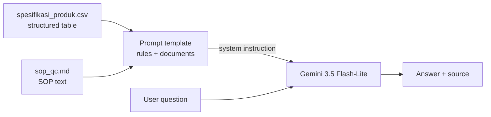

# QC Spec Assistant

An assistant for QC staff at a creamer and milk powder plant. It answers questions about product specifications and QC SOPs using only the provided documents, and every answer ends with its source. If the answer isn't in the documents, it says so instead of guessing.

Built as a capstone project for IBM SkillsBuild x Hacktiv8. Prototyped in Langflow, deployed with Streamlit.

**Live demo:** _add your Streamlit link here_

> All documents in this repo are fictional and do not come from any real company.

## Problem

In a powder manufacturing QC lab, product specifications and SOPs usually live in separate PDF files. Staff look up limits by hand when releasing a batch, filling quality documents, or replying to customer complaints. Many products share the same parameters with different limits (shelf life 12 vs 18 months, moisture max 3.0 vs 3.5%), so it's easy to copy a number from the wrong product.

## What it does

- Looks up spec limits per product, with unit and limit type (min, max, or range)
- Checks a test result against the spec and says whether it's in or out of spec, plus the SOP action
- Answers SOP procedure and complaint handling questions
- Replies "Tidak ditemukan di dokumen" when the information isn't there
- Ends every answer with the document and section it came from

## Architecture



The Langflow version uses the same six blocks: two Read File components, Prompt Template, Chat Input, Language Model, and Chat Output. Screenshot and exported flow are in [`langflow/`](langflow/).

### Why there's no vector database

Both documents together are about 14k characters, a few thousand tokens, which fits in the prompt with plenty of room. At this size retrieval only adds a way to fail: a text chunk can cut a table row away from its product code and the model then answers with another product's limit. RAG becomes worth it once the document set grows to hundreds of files, and it's on the roadmap.

## Evaluation

Two question sets, each with an answer key:

- [`eval/pertanyaan_uji.csv`](eval/pertanyaan_uji.csv): 24 questions across lookup, procedure, complaint handling, comparison, and trap questions whose answer is not in the documents. Used to find failures and improve the prompt.
- [`eval/pertanyaan_holdout.csv`](eval/pertanyaan_holdout.csv): 8 new questions written before prompt v2 was tested and never used to tune it. This is the fairer number, because any prompt fixed against the first 24 questions will score better on those same 24.

| Prompt | Test set (24) | Held-out (8) |
|---|---|---|
| v1 | 19/24 | 7/8 |
| v2 | 21/24 | 7/8 |

Model: `gemini-3.5-flash-lite`. Scored manually with a strict rule: an answer counts as correct only if it contains no wrong statement. The automatic keyword check scored v1 at 23/24, four points higher than the manual review, so it's only used as a first pass.

What v1 got wrong, the rule v2 added for it, and whether it worked:

| Failure in v1 | Rule in v2 | Fixed in v2? |
|---|---|---|
| Wrote another product's limit first, then corrected itself | Find the exact product and parameter row before writing a number | No. v2 gave the wrong limit with no correction |
| Said two shelf lives were "the same" while listing 18 and 12 months | When comparing, write both values first, the conclusion must match them | Yes |
| Gave the rule "shelf life + 6 months" without the final number | Finish any calculation the documents call for | No, on both question sets |
| Answered "not found" for a severity the SOP definitions cover | Classify by matching the case to the SOP definitions | Yes, but v2 also labeled a rancid complaint as Minor when nobody asked for a severity |
| Applied the moisture retest procedure to a pH result | Only cite an SOP action when that SOP covers the parameter | Yes, on both question sets |

What this shows: the prompt rules fixed reasoning mistakes (contradictory conclusions, refusing too early, citing the wrong SOP) but not looking up the right number or finishing a calculation. On the held-out questions both versions scored 7/8, each missing a different question, so most of the gain on the first 24 questions came from tuning against those same questions. Each set was run once, and with 8 questions a single answer moves the score by 12.5 points, so the two versions can't be told apart on held-out data. The next version should take number lookups and calculations away from the model: code finds the matching spec rows, and the model only writes the answer.

The Langflow prototype uses prompt v1 with `gemini-3.6-flash`. The deployed app uses prompt v2 with `gemini-3.5-flash-lite`, because the free tier allows only 20 requests a day for 3.6 Flash against 500 for Flash-Lite. A public demo on 3.6 Flash would run out of quota after one or two visitors.

The documents, questions, and prompt were all written by the same person, so these numbers are optimistic. They show where the prompt rules help and where they fall short, not real world accuracy.

## Run locally

```bash
git clone https://github.com/<your-username>/qc-spec-assistant.git
cd qc-spec-assistant
pip install -r requirements.txt
```

Copy `.streamlit/secrets.toml.example` to `.streamlit/secrets.toml`, paste your Gemini API key, then:

```bash
streamlit run app.py
```

Run the evaluation (Windows Command Prompt):

```bat
set GEMINI_API_KEY=your-key
python eval/run_eval.py --set uji --prompt v2
python eval/run_eval.py --set holdout --prompt v2
```

## Project structure

```
qc-spec-assistant/
├── app.py                      Streamlit app
├── qc_assistant.py             load documents, build prompt, call Gemini
├── prompts/
│   ├── system_prompt_v1.md     prompt in the Langflow prototype
│   └── system_prompt_v2.md     prompt in the deployed app
├── data/
│   ├── spesifikasi_produk.csv
│   └── sop_qc.md
├── eval/
│   ├── pertanyaan_uji.csv      24 test questions + answer key
│   ├── pertanyaan_holdout.csv  8 held-out questions + answer key
│   ├── run_eval.py
│   └── hasil_*.csv             model answers with manual review
└── langflow/                   exported flow + canvas screenshot
```

## Limitations and responsible use

- Fictional documents only. Real specification documents should not go to the free tier of the Gemini API, because Google may use free tier data to improve its products.
- Each question is answered on its own, with no chat memory.
- In/out of spec comparisons are done by the language model. Fine for a demo, but a production version should compare numbers in code.
- The public demo is limited to 15 questions per session to protect the free API quota.

## Roadmap

1. Check a draft COA against the spec table automatically. The model only extracts values from the PDF, the comparison runs in code.
2. Add retrieval with a vector store once the document set grows.
3. Run on company infrastructure with a paid or self-hosted model so real documents can be used.
